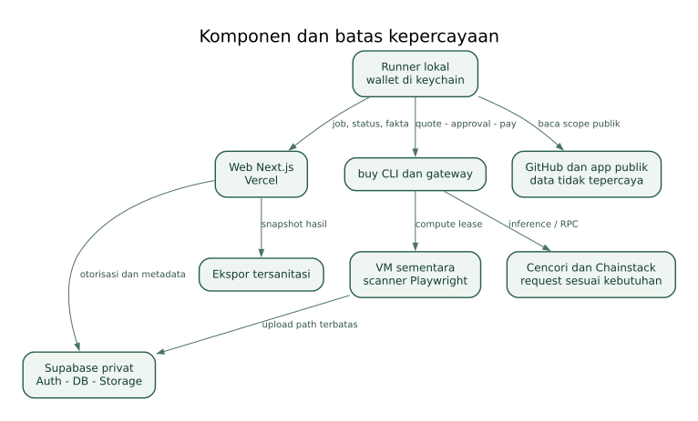

# DocketRail

**Your app. Your evidence. Ready for review.**

Paket spesifikasi final • 1 November 2026 • Pemilik: Mahdun • Track: Build with buy, Agents on Open Rails.

Dokumen ini adalah kerangka implementasi, bukan aplikasi yang sudah berjalan. Tidak ada source code aplikasi, SQL, secret, wallet, atau transaksi yang dibuat oleh paket ini. Nama file tidak memakai nomor versi. “Final” berarti satu baseline keputusan yang konsisten; hasil pengujian nyata dan perubahan aturan sponsor tetap mengalahkan asumsi dokumen.

## Cara penggunaan paket

1. Baca [prd.md](docs/prd.md) untuk kontrak produk dan batas cakupan.
2. Baca [produk-dan-ux.md](docs/produk-dan-ux.md) untuk input, layar, dan output.
3. Baca [arsitektur.md](docs/arsitektur.md), [kontrak-data-dan-api.md](docs/kontrak-data-dan-api.md), dan [agent-dan-bukti.md](docs/agent-dan-bukti.md) sebelum implementasi.
4. Ikuti [build-dan-deploy.md](docs/build-dan-deploy.md) secara berurutan. Gerbang verifikasi harus lulus sebelum membelanjakan uang atau membuka pilot.
5. Gunakan [pengujian-dan-penerimaan.md](docs/pengujian-dan-penerimaan.md) sebagai pemeriksaan sebelum demo dan deploy.

### Coba sebagai juri setelah aplikasi dibangun

1. Buka URL deployment yang dicantumkan builder pada README repo aplikasi. URL belum tersedia saat paket ini dibuat; jangan memakai domain rekaan.
2. Pilih **Explore sample pack** untuk melihat contoh berlabel ilustrasi, atau buka hasil pilot yang telah diizinkan pemiliknya.
3. Buka sebuah kebutuhan dan telusuri bukti, halaman asal, serta cakupan pemeriksaannya.
4. Unduh paket, lalu lihat pembayaran layanan yang menghasilkan bukti pada pekerjaan nyata.
5. Menjalankan pekerjaan baru memerlukan login, pairing runner lokal, saldo milik pembayar, dan persetujuan biaya. Mode contoh tidak membayar apa pun.

### Jalankan lokal setelah implementasi

Urutan operasional: pasang runtime dan dependensi terkunci, siapkan Supabase, isi konfigurasi lokal, jalankan web, jalankan runner, lalu pilih mode lokal. Perintah aplikasi belum ada karena paket ini tidak berisi implementasi; builder wajib menggantinya dengan maksimal enam perintah yang benar-benar diuji dari checkout kosong sebelum submit. Lihat [build-dan-deploy.md](docs/build-dan-deploy.md). Diagram dan contoh hasil dalam paket ini bukan screenshot aplikasi yang sudah jadi.

## Masalah

Developer yang sudah membuat Mini App masih perlu menyiapkan informasi dan bukti untuk pengajuan MiniPay. DocketRail mengurangi pekerjaan mengumpulkan dan menyusun bahan tersebut. Manfaat waktu dan kesediaan membayar belum terukur.

## Solusi dan fitur

URL aplikasi dan repo publik → rencana pemeriksaan → persetujuan → pengumpulan bukti → konfirmasi pemilik → paket pengajuan. Revisi menghasilkan pemeriksaan baru yang menyebutkan bukti lama dan bukti yang diperbarui. Dukungan utama: aplikasi React/Next.js publik dan tiga alur tanpa autentikasi/transaksi.

## Kenapa berbeda

Hasil utamanya paket pengajuan dengan asal bukti yang bisa ditelusuri. Celopedia menyediakan referensi; AskBots menyediakan review. DocketRail harus membuktikan penyelesaian pekerjaan pengumpulan bahan, bukan hanya menampilkan checklist atau pendapat AI. Belum ada klaim eksklusivitas pasar atau merek.

## Arsitektur dan stack

Next.js 16 di Vercel; Supabase Auth, Postgres, dan Storage privat; runner Node.js di komputer developer; buy CLI dengan wallet di keychain; scanner Playwright pada VM buy untuk pekerjaan berbayar. Tidak ada private key pengguna di Vercel. Tidak perlu token DocketRail atau kontrak baru, selain registrasi identitas ERC-8004 sesuai aturan track.

## Dampak dan rencana

Sasaran pilot: tiga developer independen yang benar-benar menyiapkan pengajuan. Sasaran ini bukan syarat sponsor atau bukti bahwa pengguna sudah diperoleh. Batas pengeluaran build/pengujian: **US$1 total**, termasuk pengeluaran registrasi dan pendanaan yang dibayar builder. Tidak ada penambahan anggaran otomatis.

Isi paket lainnya:

- [Integrasi dan skills](docs/integrasi-dan-skills.md)
- [Anggaran dan pembayaran](docs/anggaran-dan-pembayaran.md)
- [Keamanan dan privasi](docs/keamanan-dan-privasi.md)
- [Operasional dan pemulihan](docs/operasional-dan-pemulihan.md)
- [Pitch dan submission](docs/pitch-dan-submission.md)
- [Sumber dan verifikasi](docs/sumber-dan-verifikasi.md)
- [Pemeriksaan paket](docs/pemeriksaan-paket.md)

Seluruh keputusan produk dalam dokumen ini merupakan rancangan DocketRail. Kebutuhan resmi dan kemampuan penyedia selalu dirujuk ke sumber bernomor Sxx. Tidak ada jaminan diterima MiniPay, bebas bug, atau memenangkan hackathon.

## Diagram siap dibuka

- [Konteks sistem](docs/diagrams/konteks.svg) · [sumber Mermaid](docs/diagrams/konteks.mmd)
- [Arsitektur](docs/diagrams/arsitektur.svg) · [sumber Mermaid](docs/diagrams/arsitektur.mmd)
- [Urutan run](docs/diagrams/urutan-run.svg) · [sumber Mermaid](docs/diagrams/urutan-run.mmd)
- [State run](docs/diagrams/state-run.svg) · [sumber Mermaid](docs/diagrams/state-run.mmd)
- [Pembayaran](docs/diagrams/pembayaran.svg) · [sumber Mermaid](docs/diagrams/pembayaran.mmd)
- [Relasi data](docs/diagrams/data.svg) · [sumber Mermaid](docs/diagrams/data.mmd)
- [Gerbang rilis](docs/diagrams/release.svg) · [sumber Mermaid](docs/diagrams/release.mmd)

SVG dapat dibuka langsung di browser tanpa mengunduh renderer. Mermaid disediakan agar diagram bisa diedit atau dirender ulang. Keduanya menggambarkan relasi yang sama; penyusunan visual dapat berbeda.
