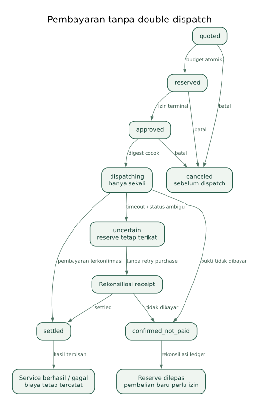

# Anggaran US$1 dan kontrak pembayaran

**Batas keras pengeluaran build/pengujian yang disepakati: US$1 total.** Tidak ada transaksi yang diizinkan hanya karena dokumen ini dibuat. Setiap pengeluaran tetap membutuhkan tindakan pemilik wallet dan pemeriksaan gerbang. Tidak ada janji modal kembali atau kemenangan.

## 1. Apa yang masuk batas

Semua pengeluaran nyata builder untuk eksperimen ini: pembayaran buy, gas registrasi ERC-8004, biaya pendanaan/transfer yang dibayar, dan fee lain yang memang timbul. Biaya langganan coding AI yang sudah dimiliki tidak diasumsikan baru dibeli. Tidak membeli domain, hosting berbayar, API subscription, atau paket layanan lain untuk proyek ini.

Saldo yang dipindahkan ke wallet bukan seluruhnya biaya habis; ledger membedakan saldo, biaya transfer, dana direservasi dan pembayaran settled. Rencana tetap tidak boleh memerlukan dana baru melebihi batas yang diizinkan. Minimum withdrawal exchange dapat menjadi penghalang walaupun gas kecil. Bila pengguna belum punya stablecoin di Celo, periksa biaya/minimum rute pendanaan sebelum menyetujui rencana.

Pendanaan pilot oleh pengguna lain tidak dipakai untuk menyembunyikan tambahan pengeluaran yang dikendalikan builder. Seluruh eksperimen mainnet pilot terkendali dicatat dalam envelope yang sama. Penggunaan publik berikutnya memerlukan keputusan anggaran baru; dokumen ini tidak mengotorisasinya.

## 2. Pembagian envelope

- Registrasi identitas + biaya pendanaan: maksimum US$0,20 sebagai reservasi perencanaan, bukan hasil estimasi gas.
- Eksperimen layanan: maksimum US$0,60.
- Cadangan belum dialokasikan: US$0,20. Memindahkan cadangan ke kategori lain memerlukan konfirmasi pemilik; total tetap US$1.

Jika registrasi/pendanaan lebih dari US$0,20, jangan lanjut otomatis. Hitung ulang cakupan di dalam US$1 dan minta keputusan pengguna bila diperlukan. Tidak menganggap biaya registrasi gratis atau pasti muat.

## 3. Harga indikatif yang diperiksa

Katalog VM pada 1 November 2026: lease awal 3.600 detik, e2-medium 4 GiB US$0,067011; bukan tarif per menit. Cencori US$0,01 per request dan Chainstack US$0,01 per request/batch yang didukung. Katalog dapat berubah; 402 quote atas body aktual adalah acuan transaksi [S03](sumber-dan-verifikasi.md#s03), [S04](sumber-dan-verifikasi.md#s04), [S05](sumber-dan-verifikasi.md#s05), [S06](sumber-dan-verifikasi.md#s06).

Ilustrasi maksimum satu run: satu VM 0,067011 + tiga completion 0,03 + satu batch RPC 0,01 = **US$0,107011**. Batas run internal US$0,12. Ini bukan benchmark: bootstrap/Chromium bisa gagal, dan lease tambahan adalah pembelian baru.

Ilustrasi lima run penuh: lima VM 0,335055 + 15 completion 0,15 + lima batch RPC 0,05 = **US$0,535055**. Sisa envelope layanan US$0,064945. Lima run mencakup kira-kira satu integrasi awal, tiga pilot, dan satu demo; sasaran, bukan kewajiban membelanjakan semua. Reuse hasil dan pengembangan lokal mengurangi kebutuhan.

Gunakan tipe VM yang terbukti cukup. e2-medium dipilih sebagai kandidat Playwright, bukan fakta performa yang sudah diuji. Jika bootstrap tidak stabil, berhenti dan perbaiki lokal; jangan terus membeli mesin lebih besar. Jenis mesin tertentu membutuhkan Self; tidak mengasumsikan semua pengguna memenuhi syarat.

## 4. Urutan pengeluaran

Pertama: uji seluruh pipeline lokal gratis dengan fixture dan situs yang diizinkan. Kedua: cek keychain/CLI tanpa pembayaran. Ketiga: dapatkan estimasi gas registrasi dan biaya pendanaan. Keempat: satu percobaan VM setelah data lokal/upload lulus. Kelima: pilot nyata hanya jika percobaan awal menghasilkan bukti berguna dan sisa envelope mencukupi.

Registrasi ERC-8004 wajib menurut track [S01](sumber-dan-verifikasi.md#s01). Sebelum membayar gas, pastikan wallet/identitas yang diregistrasikan cocok dengan entry proyek. Jika sudah mempunyai identitas yang valid, periksa apakah dapat digunakan; jangan membuat identitas kedua tanpa kebutuhan. ERC-8004 merupakan identitas, bukan biaya lisensi DocketRail.

## 5. Quote, approval, dan reservasi

Setiap panggilan berbayar mempunyai attempt ID sendiri. Runner membaca katalog gratis, membuat permintaan persis, memperoleh 402 quote, lalu mengirim rincian tersanitasi ke backend untuk reserve atomik. Total outstanding termasuk attempt uncertain. Approval terminal menyebut layanan, tujuan, token, maksimum, dan saldo anggaran tersisa.

Persetujuan internal berlaku paling lama dua menit dan hanya untuk body digest, method, URL dan token yang ditampilkan. Batas dua menit adalah kebijakan DocketRail, bukan janji masa berlaku quote provider. Perubahan harga/body/token mewajibkan quote dan approval baru. CLI max-amount memakai whole token units; MCP maxAmount memakai atomic units sesuai docs. Karena MVP memakai CLI, konversi harus diuji dengan golden cases.

Jangan menjalankan quote berbayar palsu; quote resmi bersifat read-only. Jangan memakai command buy send untuk membayar service x402. Pembayaran x402 dilakukan client buy sesuai penawaran layanan.

## 6. Batas pengeluaran yang benar-benar dapat ditegakkan

Backend menyimpan total dan menolak reserve yang melampaui envelope global/run. Runner juga mempunyai lifetime counter lokal dan daily cap buy sebagai lapis tambahan. Daily cap bukan pengganti batas seumur eksperimen karena reset harian; saldo wallet terpisah juga bukan kontrol total lintas wallet.

MVP invite-only, operator dan peserta pilot menjalankan binary tepercaya, satu job aktif per runner. Kontrol ini mencegah pengeluaran melalui DocketRail; tidak dapat mencegah pemilik wallet memakai CLI lain di luar produk. Batas global harus meliputi pengeluaran manual yang dicatat operator. Jika ledger/back-end tidak tersedia, fail closed: tidak membayar.

Untuk CELO gas, simpan jumlah native dan estimasi USD dengan source/time. Sebelum transaksi, reserve batas atas gas yang ditampilkan wallet ditambah fee pendanaan yang diketahui. Jika valuasi tidak tersedia atau total tidak muat, jangan kirim. Gas aktual direkonsiliasi setelah receipt. Tidak mengarang jumlah CELO tetap sebagai biaya registrasi.

## 7. Ketidakpastian pembayaran

Timeout setelah dispatch, settle_uncertain, atau provision_failed dapat terjadi setelah dana berpindah. Attempt tetap uncertain/settled sesuai bukti; reserve tidak dilepas karena HTTP error. Runner mencari receipt resmi dan memeriksa poll provider sebelum langkah baru. Tidak memberi retry otomatis walaupun HTTP 500 biasanya dianggap sementara.

Jika tidak ditemukan bukti cukup, status tetap payment_uncertain, saldo dianggap terikat, dan pemilik memilih rekonsiliasi manual. Jangan mengurangi ledger hanya karena VM sudah kedaluwarsa. Pembelian VM baru sesudah expired merupakan biaya baru dan memerlukan approval baru.

## 8. Bukti pembayaran dan atribusi

Simpan payer, payTo/provider jika tersedia, network, token/address, amount, tx hash, purpose, run dan hasil artefak. Receipt provider belum sama dengan observasi onchain independen. Verifikasi mainnet receipt melalui explorer/RPC yang sesuai; utamakan layanan publik yang tersedia tanpa menambah biaya untuk setiap polling.

FAQ Build with buy menyatakan attribution tag tidak diperlukan dan x402 belum mendukungnya, tetapi teks lain pada halaman masih menyebut tagged wallet. Karena itu, catat wallet identitas proyek, payer aktual, provider/payTo, dan semua hash; konfirmasi mekanisme kredit proyek di registrasi/office hours. Jangan menambahkan calldata sembarang ke payment authorization atau mengklaim tag telah didukung [S01](sumber-dan-verifikasi.md#s01).

Pengguna independen bukan sekadar login berbeda. Pemilik dana, otorisasi dan aktivitas wallet sebelumnya harus dijelaskan sesuai aturan; pengguna baru dapat diukur dengan cara lain menurut FAQ. Jangan mendanai wallet baru lalu menyebutnya independen.

## 9. Kondisi berhenti

Berhenti jika biaya pendanaan melewati batas, keychain tidak berjalan, tidak ada estimasi registrasi, quote berubah, target belum disetujui, ada attempt uncertain, ledger tidak tersedia, atau sisa anggaran kurang. Hasil lokal tetap dapat ditinjau, tetapi tidak dilabeli integrasi mainnet selesai. Mendapatkan pengguna dan kualitas bukti lebih penting daripada menghabiskan US$1.
