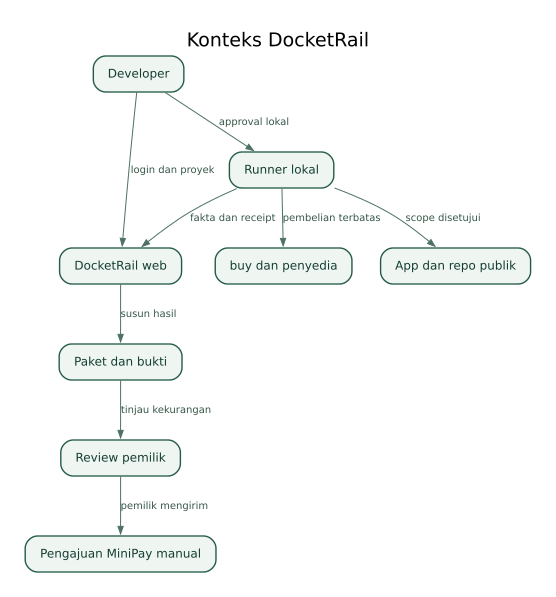
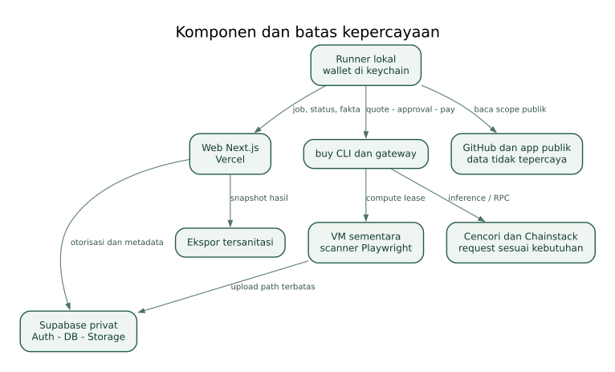
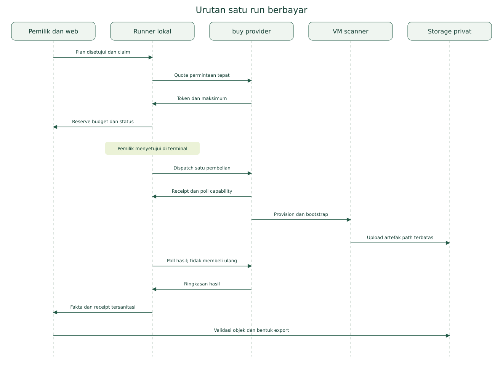
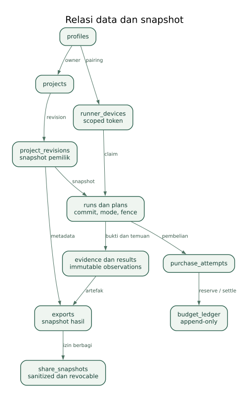

# Arsitektur DocketRail

Baseline implementasi: satu repo, satu web deployment, satu proyek Supabase, runner lokal per pengguna, VM sementara per run berbayar. Baca [prd.md](prd.md) untuk tujuan dan batas produk. Istilah serta state di [kontrak-data-dan-api.md](kontrak-data-dan-api.md) bersifat kanonis.

## 1. Konteks dan batas sistem

Web adalah control plane: login, proyek, rencana, konfirmasi, status dan laporan. Runner adalah execution coordinator milik developer: membaca sumber publik, meminta quote, mendapatkan persetujuan terminal, membeli layanan, memantau hasil dan mengirim fakta. VM adalah scanner sementara; ia tidak memegang wallet atau memutuskan pembayaran.

Tidak ada asumsi bahwa @celo/buy menyediakan SDK server, browser signer, remote signer, atau keychain yang otomatis cocok untuk Vercel. Integrasi awal menggunakan CLI yang didokumentasikan. Runner tidak menerima perintah shell dari web. Web hanya mengirim job plan dengan tipe dan nilai yang tervalidasi.

## 2. Komponen dan tanggung jawab

### Web — Next.js 16 App Router, Vercel

Menangani halaman, callback OAuth, API pendek, otorisasi, validasi, mint capability upload, share snapshot, dan export. Web tidak membuka browser target, menginstal Chromium, menjalankan shell scanner, menunggu provisioning VM, atau menyimpan private key. Tidak ada antrean in-memory di Vercel.

Data pengguna tidak di-cache sebagai halaman publik. Hasil user-authenticated dan API runner diberi kebijakan no-store. Share hanya mengambil snapshot tersanitasi yang dibentuk untuk tujuan tersebut. Tidak menggunakan static export karena auth dan API server dibutuhkan [S19](sumber-dan-verifikasi.md#s19).

### Supabase

Auth GitHub untuk identitas, Postgres untuk metadata/state/reservasi, Storage privat untuk artefak. Browser memakai publishable key yang memang publik; secret server tidak pernah diberi awalan NEXT_PUBLIC. RLS berlaku untuk tabel pemilik dan storage. Aksi budget dan transisi run harus atomik melalui fungsi database yang hanya dipanggil backend.

MVP memakai polling web setiap lima detik selama layar run aktif. Supabase Realtime tidak wajib. Ketika tidak ada run aktif, polling berhenti. Cleanup dijalankan melalui tugas operator yang eksplisit; bukan request pengguna acak.

### Runner — Node.js 22, komputer developer

Satu proses aktif, memakai lock OS lokal, kredensial pairing di penyimpanan OS, dan akun buy khusus. Tidak mengakses private key buy secara langsung; CLI mengelola penandatanganan. Semua child process memakai argumen terpisah dan stdin/file yang terkontrol, tanpa interpolasi shell dari URL/hasil AI. Pengguna tetap memberi persetujuan lokal atas setiap quote.

Platform awal yang dijanjikan hanya lingkungan yang lulus G-03. Windows/WSL tidak otomatis dianggap identik: keychain WSL, Node Windows, dan browser wallet berbeda. Jalankan web, runner, dan buy dalam lingkungan yang jelas; bila keychain tidak didukung, pekerjaan berbayar tetap nonaktif. Jangan membuat fallback ke private key plaintext.

Runner menyimpan journal lokal tersanitasi untuk kemampuan resume. Capability provider yang perlu untuk polling disimpan terenkripsi di keychain, bukan di Supabase. Journal tanpa secret memuat attempt ID, job ID, payer, waktu, quote digest, dan langkah terakhir.

Ketentuan keychain tersebut berlaku pada penyimpanan yang dikelola DocketRail. CLI buy mempunyai receipt store sendiri dan dapat mempertahankan poll capability menurut dokumentasinya. Periksa lokasi serta permission store CLI, batasi ke user OS, dan jangan menyatakan seluruh receipt CLI otomatis terenkripsi. Jangan menyalin receipt mentah ke repo, log web, atau ekspor.

### Scanner — Playwright pada VM buy

Menggunakan program scanner milik DocketRail yang dipin ke commit dan checksum. Target diperiksa sebagai situs tidak tepercaya; kode target tidak diinstal atau dijalankan sebagai paket. VM disediakan dalam keadaan Debian; bootstrap menginstal runtime dan browser yang dibutuhkan dengan batas waktu. Batas 4 KiB script provider ditangani dengan bootstrap kecil yang mengambil bundle tepercaya dan memverifikasi hash [S04](sumber-dan-verifikasi.md#s04).

Scanner memproses config run yang terbatas, mengumpulkan fakta/screenshot, mengunggah artefak melalui capability path tertentu, lalu mengeluarkan ringkasan kecil. Tidak mengekspos web server inbound dan tidak memakai SSH pada MVP. Semua komunikasi lewat HTTPS keluar. Secret upload tidak dicetak ke stdout.

### Layanan eksternal

buy VM untuk compute; Cencori untuk paling banyak tiga inference teks per run jika dipakai; Chainstack untuk satu batch RPC opsional yang dibutuhkan hasil pengguna. GitHub untuk sumber publik. PageSpeed Insights untuk laporan publik jika dapat diperoleh; hasilnya external_report dan tidak dianggap paid buy. Tidak menambah provider untuk mengejar jumlah integrasi.

## 3. Topologi dan aliran kepercayaan

Boundary A — browser/web: session cookie pengguna dan pemeriksaan otorisasi server. Boundary B — web/runner: pairing token terbatas, hashed at rest, kedaluwarsa dan dapat dicabut. Boundary C — runner/buy: quote/approval dan keychain, tidak ada akses private key dari situs target. Boundary D — VM/Storage: capability per run dan path, bukan Supabase service key. Boundary E — aplikasi/repo target: seluruh isinya data tidak tepercaya, tidak dapat mengubah budget/provider/action schema.

## 4. Struktur repo yang direncanakan

- apps/web: UI, callback auth, Route Handlers, halaman demo read-only.
- apps/runner: pairing client, journal, pembungkus buy CLI, polling dan pengiriman hasil.
- packages/contracts: tipe domain, validasi, status, schema fakta, dan format ekspor; tidak ada ketergantungan Next.js di runner.
- packages/scanner: Playwright collector, network sanitization, screenshot processing, trusted bootstrap release material.
- packages/reporting: pembentukan Markdown/CSV/JSON dari fakta yang sama; AI tidak menulis file ekspor secara bebas.
- supabase/migrations: skema dan kebijakan akses, dibuat saat implementasi.
- tests: fixture lokal, acceptance dan integrasi terkontrol.
- docs: salinan spesifikasi ini yang relevan untuk repo; sumber tetap bernomor.

Gunakan workspace package manager tunggal; tidak perlu Turborepo, microservices, Redis, Docker cluster, vector database, atau framework multi-agent untuk MVP. Nama direktori adalah kerangka, bukan file kode yang telah dibuat.

## 5. Pairing runner

1. Runner membuat verifier acak 32 byte, lalu memulai pairing pada API resmi. Server hanya menyimpan hash verifier dan kode manusia singkat; request kedaluwarsa sepuluh menit.
2. Terminal menampilkan URL web dan kode, identitas perangkat serta fingerprint; tidak menampilkan wallet secret. Browser login dan pengguna menyetujui kode yang sama.
3. Runner melakukan polling dengan pairing ID dan verifier rahasia. Setelah approval, server menerbitkan runner token acak sekali, scope pemilik dan proyek yang disetujui, masa berlaku 24 jam. Server menyimpan hash token saja.
4. Token disimpan dalam keychain DocketRail. Re-pair diperlukan setelah expired/revoked. Polling pairing memiliki rate limit dan backoff; setelah token diambil, pairing tidak dapat dipakai ulang.

Ini protokol aplikasi DocketRail yang harus dibangun dan diuji, bukan endpoint bawaan Supabase. API pairing tidak memberi wewenang membelanjakan dana. Runner meminta izin terminal untuk setiap pembayaran, walaupun job telah disetujui di web. Tidak ada port localhost yang dapat diperintah oleh origin web arbitrer.

## 6. Siklus satu run

Run dibentuk dari snapshot proyek dan revision plan. Claim menggunakan transaksi atomik, runner ID dan fencing generation. Heartbeat setiap 15 detik; lease koordinasi 90 detik. Lease ini berbeda dari lease VM satu jam. Habisnya lease koordinasi tidak berarti VM berhenti atau pembayaran batal.

Runner membaca sumber publik, mengirim fakta kecil dan meminta inference jika diperlukan, lalu mengajukan plan kepada pemilik. Jika hasil inference mengubah flow, pengguna mengonfirmasi revision baru sebelum scan. Quote berbayar terikat ke method, URL provider allowlist, body digest, token, maksimum dan waktu kedaluwarsa internal.

Setelah reservasi berhasil dan pengguna menyetujui quote, attempt ditandai dispatching sebelum CLI dipanggil. Setelah itu, attempt tidak boleh di-dispatch ulang, bahkan jika runner crash. Resume harus mencari receipt dan hasil provider terlebih dahulu. Tidak mengandalkan provider mempunyai idempotency key karena belum didokumentasikan.

VM menerima config dan upload capabilities yang disiapkan sebelum dispatch. Runner memantau poll URL dan mencocokkan artefak. Fakta menjadi temuan deterministik; ringkasan teks opsional memakai inference yang direservasi tersendiri. Pemilik meninjau lalu export snapshot.

## 7. Upload dan pengambilan artefak

Backend menghasilkan signed upload untuk daftar path yang sudah ditentukan di bucket privat. VM hanya menerima capability untuk file run tersebut. Dokumentasi Supabase menyebut signed upload berlaku dua jam [S15](sumber-dan-verifikasi.md#s15); jangan menyebutnya sekali pakai atau dapat dicabut per token jika belum dibuktikan. Pilih upsert nonaktif dan validasi hasil sesudah upload.

Path berformat owner/project/run/evidence-id dengan ekstensi yang diizinkan. Backend menetapkan expected MIME, ukuran maksimum dan nama; VM tidak menentukan bucket atau owner. Scan config mempunyai TTL 30 menit dan diambil melalui token berbeda dengan izin baca config saja. Signed upload dapat bertahan lebih lama dari config; karena itu finalisasi hanya menerima path dan hash dalam run yang sah, belum dihapus, dan fence yang benar.

Sebelum menandai artefak siap, backend memeriksa objek ada, ukuran/MIME dan hash; bila perlu unduh kecil untuk menghitung hash ulang. Gagal upload menghasilkan partial, bukan run sukses tanpa bukti. Tidak mengirim gambar base64 besar lewat stdout/poll. Poll stdout hanya ringkasan dan ID, bukan capability URLs.

## 8. Pemisahan mode

Local: scanner di komputer pengguna, tidak memanggil buy, tidak menghasilkan receipt mainnet. Fakta tetap berguna tetapi capture environment dan mode dicatat lokal. Target tetap situs publik yang disetujui; fixture lokal digunakan hanya pada development, tidak diklaim pengamatan deployment pengguna.

Mainnet: VM dibeli lewat buy. Tidak ada simulasi settlement. Pembayaran atau provider gagal tidak diganti label sukses. Halaman contoh: snapshot ilustrasi yang diberi label; tidak membelanjakan dana dan tidak dihitung pilot independen.

## 9. State, concurrency, dan konsistensi

State server merupakan sumber status bersama. Runner journal merupakan sumber pemulihan attempt lokal. Satu claim aktif per run; unique constraints menjaga event, artefak dan receipt tidak terduplikasi. Jika backend tidak dapat memastikan reserve budget, runner dilarang membayar meskipun saldo wallet cukup.

Proyeksi ledger dihitung dalam transaksi terkunci: outstanding reservation adalah reserve yang belum dikonsumsi settle atau release. Saat settle, reservasi dikonsumsi dan jumlah aktual dipindah ke settled dalam transaksi yang sama, sehingga tidak dihitung dua kali. Reserve untuk attempt uncertain tidak dikonsumsi sampai hasilnya diketahui. Biaya aktual yang melebihi quote yang disetujui merupakan incident, bukan izin memperbesar limit.

Fencing mencegah runner lama menyelesaikan run baru. Hasil lama boleh diarsipkan sebagai late_result untuk rekonsiliasi, tidak menimpa snapshot yang telah diekspor. Server tidak mengambil alih wallet runner yang offline. Run tidak dibeli ulang otomatis oleh runner lain.

## 10. Deploy dan kapasitas

Vercel melayani request pendek; fungsi mempunyai batas platform [S20](sumber-dan-verifikasi.md#s20). Export maksimum 10 MB dengan input metadata kecil, gambar sudah tersimpan dan disanitasi; ukur kebutuhan memori/durasi dan hentikan jika tak muat. Tidak membuat ZIP dari seluruh bucket.

ZIP hasil diunggah backend ke bucket privat docketrail-exports. Respons API hanya berisi ID/status dan tautan download singkat sesudah otorisasi; byte ZIP tidak diproksikan sebagai response Vercel. Ini memisahkan ukuran paket 10 MB dari batas payload fungsi platform. Jika pembuatan/upload tidak selesai dalam batas request yang telah diuji, export ditandai gagal dan hasil lama dipertahankan; tidak mengandalkan proses background in-memory yang dapat dihentikan runtime.

Pilot invite-only, satu run aktif per runner. Setiap pengguna dibatasi lima proyek dan 20 run tersimpan; retensi artefak 30 hari dengan pemberitahuan. Default batas global mainnet dikelola operator; tidak ada open signup yang dapat menguras wallet.

Pada 10.000 pengguna, desain pilot tidak boleh diklaim siap: polling, Storage egress, DB RLS/index, rate limit GitHub, onboarding runner dan dukungan akan dominan. Perlu desain kapasitas dan unit economics baru sebelum trafik tersebut. Tidak mengaktifkan worker selalu hidup atau memindahkan private key ke cloud sebagai shortcut.

## 11. Keputusan yang tidak boleh berubah diam-diam

ADR-01: runner lokal, keychain lokal; friksi diterima untuk menjaga custody dan biaya.

ADR-02: scanner tepercaya di VM, tidak build repo target; pemeriksaan runtime wallet tetap perangkat fisik.

ADR-03: laporan deterministik dengan teks AI terbatas; tidak ada model yang memutuskan lulus atau menaikkan budget.

ADR-04: satu Postgres sebagai state dan budget; tidak menambah antrean eksternal sebelum ada kebutuhan.

ADR-05: URL-only menghasilkan web-only, tidak meminta private repo token.

ADR-06: setiap pembelian butuh quote dan persetujuan; seluruh attempt tidak pasti tetap mengunci dana sampai diselesaikan.

ADR-07: tidak ada kontrak/token DocketRail. Identitas ERC-8004 disiapkan manual dari wallet yang didaftarkan sesuai aturan.
