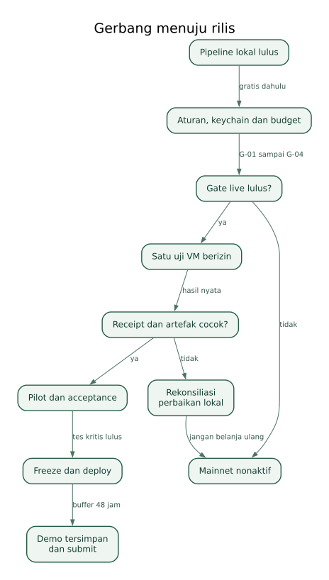

# Urutan build sampai deploy

Panduan implementasi tanpa source code. Setiap fase menghasilkan bukti dan memiliki syarat lanjut. Stack final mengikuti [arsitektur.md](arsitektur.md). Anggaran mengikuti [anggaran-dan-pembayaran.md](anggaran-dan-pembayaran.md).

## 1. Jadwal dan buffer

Deadline resmi: **9 November 2026 pukul 09:00 GMT = 16:00 WIB** [S01](sumber-dan-verifikasi.md#s01). Waktu kerja dari tanggal dokumen 1 November sekitar delapan hari. Feature freeze: **7 November pukul 16:00 WIB**, menyisakan 48 jam atau sekitar seperempat jendela untuk buffer. Jika mulai lebih lambat, kurangi fitur di luar inti; jangan menghapus buffer secara diam-diam.

1 November: pastikan aturan/eligibility, siapkan repo, skills, lingkungan dan model domain; uji source read + scanner lokal paling kecil. Tidak membeli VM.

2 November: auth, RLS, proyek, revision, requirement statuses, dan halaman hasil. Hasil sample jelas berlabel ilustrasi.

3 November: collector lokal, redaksi, inventaris dan ekspor. Lulus satu end-to-end lokal dengan kontrak artefak yang sama seperti live.

4 November: pairing runner, ledger, quote parsing dan pemulihan dengan fake provider. Estimasi registrasi/pendanaan dan keputusan G-02 sebelum live.

5 November: registrasi yang diperlukan dan satu uji VM buy apabila budget dan gerbang lulus. Selesaikan upload/receipt nyata. Jika gagal, perbaiki lokal sebelum mempertimbangkan transaksi berikutnya.

6 November: pilot independen, perbaikan penghambat, input bukti perangkat bila tersedia, konfirmasi penggunaan hasil.

7 November sebelum 16:00 WIB: acceptance suite, demo, export, perbandingan baseline, lalu freeze.

8 November: video, README, pengecekan deployment dari luar, izin publikasi, draft form dan backup.

9 November: smoke test singkat dan submit lebih awal; target internal sebelum 12:00 WIB, bukan menunggu 15:59 WIB. Jangan membeli run demo baru jika bukti tersimpan sudah cukup atau saldo tidak muat.

## 2. Fase persiapan

Buat public GitHub repo sesuai aturan registrasi, tanpa secret. Catat tanggal mulai dan scope kode yang ditulis selama event. Konfirmasi apakah solo dan penggunaan coding AI diperbolehkan dalam aturan entry; halaman publik yang diperiksa belum menegaskannya. Jangan menyimpulkan dari aturan event lain.

Instal Node.js 22 pada lingkungan yang didukung, satu package manager, lalu skills resmi dari [integrasi-dan-skills.md](integrasi-dan-skills.md). Kunci versi dependensi dan scanner. Lihat help CLI buy tanpa setup wallet bila belum diperlukan. Wallet baru dibuat hanya setelah pemilik mengetahui address dan perannya.

## 3. Fase fondasi data dan web

Siapkan Supabase project pada plan yang diizinkan akun. Konfigurasikan GitHub OAuth app, callback URL dari dashboard Supabase, Site URL web, redirect allowlist lokal/production, dan jangan memakai wildcard luas untuk production. Scope identitas saja.

Bangun skema, constraints, indeks, RLS dan bucket privat sesuai kontrak. Jalankan migration lokal atau staging dahulu; server secret tidak dipakai sebagai browser client. Uji dua user sebelum menambahkan scanner atau pembayaran.

Implementasikan layar proyek, plan dan hasil dengan sample dataset berlabel. Jangan menghubungkan tombol live ketika backend budget belum siap. Tambahkan export deterministik dari data yang sama yang dilihat UI.

## 4. Fase collector lokal

Bangun scanner dengan schema input terbatas dan output fakta. Uji viewport, HTTP errors, network sanitization, batas file serta upload ke bucket privat. Simulasikan target open-in-MiniPay dan kegagalan browser. Tidak perlu inference untuk membuat pipeline pertama bekerja.

Siapkan distribusi bundle scanner immutable yang dapat diambil lewat HTTPS oleh VM. Bundle bootstrap dan config bukan file target. Verifikasi checksum dan cara mengunggah hasil tanpa service key. Uji sandbox/firewall pada Debian yang sesuai sebelum membayar provider.

## 5. Fase runner dan pembayaran

Bangun pairing, penyimpanan token aman, claim/fence, heartbeat, journal, dan resume. Implementasikan adapter CLI berdasar help/output aktual versi terkunci. Proses child memakai daftar argumen, bukan shell interpolation. Tes fake provider untuk crash setelah dispatch dan ambiguous settlement.

Konfigurasikan akun buy khusus, daily cap sebagai tambahan, serta lifetime/global ledger. Dapatkan quote dan tampilkan tanpa membayar. Pastikan token/network, saldo dan biaya pendanaan cocok. Simulasikan gas registrasi melalui wallet/alat yang benar sebelum menandatangani; simpan estimasi, bukan private key.

Mainnet feature flag tetap off sampai G-01–G-04 lulus. Paid calls tidak dijalankan sebagai bagian CI atau build hook Vercel. Setelah satu uji berizin, simpan output tersanitasi untuk regression parser.

## 6. Inventaris konfigurasi

Berikut nama konfigurasi rancangan; nilainya berasal dari akun/deployment nyata dan tidak disertakan dalam dokumen.

Web publik: NEXT_PUBLIC_SUPABASE_URL, NEXT_PUBLIC_SUPABASE_PUBLISHABLE_KEY, NEXT_PUBLIC_APP_URL. Publishable key bukan private key.

Web server-only: SUPABASE_SECRET_KEY, DOCKETRAIL_PILOT_ENABLED, DOCKETRAIL_MAINNET_ENABLED, DOCKETRAIL_TOTAL_BUDGET_MICRO_USD dengan default 1000000, DOCKETRAIL_SERVICE_BUDGET_MICRO_USD dengan default 600000, DOCKETRAIL_RUN_BUDGET_MICRO_USD dengan default 120000. Gunakan jenis secret key yang didukung project Supabase, bukan menebak interchangeability format legacy.

Runner nonsecret: DOCKETRAIL_API_URL, DOCKETRAIL_RUNNER_NAME, DOCKETRAIL_BUY_ACCOUNT, DOCKETRAIL_SCANNER_BUNDLE_URL, DOCKETRAIL_SCANNER_BUNDLE_SHA256. Runner token dan provider capability disimpan keychain, tidak dalam file env yang bisa ter-commit.

VM config per run: run ID, fence, plan digest, scope, batas, scanner checksum, config capability dan upload slots. Tidak ada service key, wallet key, runner bearer token, atau Supabase user session.

Flag dev/preview: pilot lokal boleh aktif, mainnet selalu off. Production mainnet tetap off sampai operator melakukan gate enable eksplisit. Limit dalam database tetap berlaku walaupun env salah dinaikkan; update budget tidak boleh terjadi dari browser/runner.

## 7. Deploy web

Hubungkan repo ke Vercel, pilih apps/web sebagai root workspace, pastikan package manager dan lockfile terdeteksi. Isi env preview dan production terpisah. Gunakan domain bawaan deployment; tidak membeli domain dalam anggaran ini.

Jalankan migration yang diuji sebelum release yang memerlukan schema baru. Gunakan perubahan additive; jangan menghapus kolom penting ketika runner lama masih aktif. Preview tidak memakai production secret yang memberi akses data pilot.

Deploy sebagai server Next.js, periksa OAuth redirects, RLS, signed upload, no-store dan export. Vercel Functions bukan tempat menjalankan runner/VM poll panjang. Konfirmasi plan hosting sesuai ketentuan akun; tidak mengaktifkan upgrade berbayar otomatis.

## 8. Distribusi runner

Untuk hackathon, distribusi melalui repo publik dan instruksi CLI yang diuji; tidak perlu mengklaim package npm DocketRail sudah diterbitkan. Cantumkan OS/runtime yang benar-benar diuji dan checksum/commit. Pengguna menjalankan runner dari checkout tepercaya dan meninjau wallet/budget sebelum transaksi.

Tidak menyisipkan setup wallet ke instalasi otomatis. Pairing ke origin resmi saja, fingerprint terlihat, revoke tersedia. Jika runner berhenti, laporan lama masih tersedia; UI menampilkan pekerjaan baru belum dapat dimulai.

## 9. Smoke test production

Buka landing dari sesi tanpa login; contoh dapat dibaca. Login/callback berhasil. User baru tidak melihat data user lain. Proyek baru dapat dibuat. Runner dapat pair/revoke. Lokal end-to-end menghasilkan ZIP valid. Mainnet route tetap tertutup sampai gate.

Setelah live diaktifkan, cukup verifikasi satu run yang telah diizinkan; receipt dan artefak tampil tanpa secret. Uji stop tanpa menjanjikan refund. Recheck metadata tidak membeli VM. Share preview/revoke bekerja. Log tidak memuat URL bertoken.

## 10. Rollback dan pemulihan

Rollback web ke deployment sebelumnya yang kompatibel, matikan mainnet flag, pertahankan ledger/receipts dan bucket. Jangan menghapus database untuk memperbaiki UI. Runner lama kehilangan claim baru tetapi masih dapat merekonsiliasi attempt yang terlanjur dispatch; endpoint recovery read/result tetap tersedia selama incident.

Jika migration merusak akses, pulihkan dari strategi backup/export yang tersedia pada plan sebenarnya; jangan mengklaim PITR tersedia pada free plan. Sebelum perubahan schema berisiko, ekspor metadata dan checksum artefak dengan cara aman. Lihat [operasional-dan-pemulihan.md](operasional-dan-pemulihan.md).

## 11. Definisi siap deploy

Seluruh acceptance kritis lulus, snapshot build/runner/scanner tercatat, biaya direkonsiliasi, status gerbang jujur, URL publik dan video dapat diakses, README aplikasi mempunyai cara coba serta maksimal enam perintah lokal yang telah diuji. Tidak ada placeholder domain, klaim pengguna palsu atau paid receipt ilustrasi yang disamarkan sebagai nyata.
