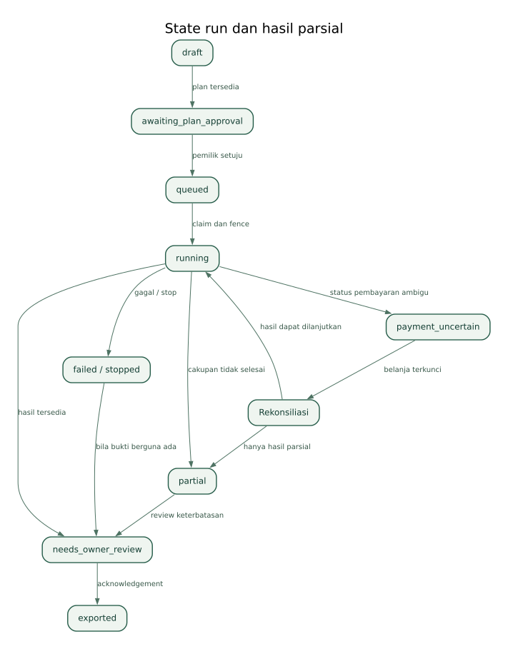
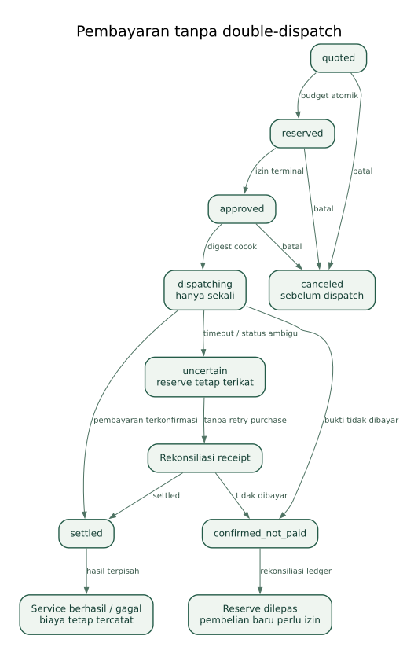

# Kontrak data, state, dan API

Dokumen ini merancang API internal DocketRail, bukan mengklaim endpoint berikut sudah tersedia atau milik sponsor. Tidak berisi SQL atau kode implementasi. Semua timestamp disimpan UTC ISO 8601 dan ditampilkan sesuai locale; jadwal lomba memakai Asia/Jakarta.

## 1. Prinsip tipe data

ID objek internal: UUID. Commit repo: SHA hasil resolve resmi GitHub. Alamat EVM: divalidasi sebagai alamat 20 byte; simpan normalisasi dan tampilkan checksum bila tersedia. Tx hash: 32 byte hex tervalidasi. Chain ID: integer positif, pemeriksaan receipt paid integration wajib Celo mainnet 42220.

Uang stablecoin: token address + network + decimals yang diverifikasi + atomic amount string integer. Perhitungan tidak memakai floating point. Nilai anggaran USD: integer micro-USD; batas total 1.000.000. Nilai stablecoin yang diasumsikan setara dolar diberi valuation source/time; depeg atau token tak dikenal menghentikan pembelian.

Status kebutuhan: evidence_available, needs_fix, needs_owner_confirmation, not_checked. Applicability: applicable, not_applicable, unknown. Method bukti: browser_observed, source_reference, owner_supplied, rpc_observed, external_report. Mode run: local atau mainnet. Demo adalah asal dataset sample, bukan mode pembayaran.

## 2. Entitas domain

### profiles

user_id sebagai primary key dan relasi ke Supabase Auth, display_name, created_at, pilot_allowed. Tidak menyimpan provider OAuth access token atau password. Pilot_allowed hanya dapat diubah operator.

### projects

id, owner_id, display_name, application_url, canonical_origin, repo_url opsional, repo_subdir opsional, submission_stage, created_at, updated_at, deleted_at. Owner immutable. Perubahan origin/repo/stage menghasilkan revision proyek, bukan mengubah run historis.

### project_revisions

id, project_id, revision_number, metadata, metadata_provenance, source_commit, confirmed_by, confirmed_at, created_at. Unik project_id + revision_number. Metadata tidak menyatakan hubungan deployment/commit telah dibuktikan jika baru dikonfirmasi pemilik.

### runner_devices dan pairings

Runner: id, owner_id, name, fingerprint, token_hash, token_expires_at, revoked_at, last_seen_at, supported_environment. Pairing: id, verifier_hash, user_code_hash, expires_at, approved_owner_id, claimed_at, failed_attempt_count. Tidak menyimpan verifier/token plaintext. Token replacement mencabut token sebelumnya.

### runs

id, owner_id, project_id, project_revision_id, parent_run_id opsional untuk recheck, mode, state, plan_revision, plan_digest, source_commit, runner_id, fence, claimed_at, heartbeat_at, coordination_expires_at, started_at, ended_at, stop_requested_at, capture_summary, failure_code. Run completion tidak menyatakan needs_fix telah hilang.

### run_plans

run_id + revision, proposed_by, allowed_origin, approved_external_origins, flows, exclusions, maximum_pages, maximum_steps, viewport, budgets, digest, approved_by, approved_at. Menyimpan hanya action yang diizinkan. Modifikasi memerlukan persetujuan plan revision baru; approval lama tidak berlaku.

### requirements_catalog dan requirement_results

Catalog: requirement_id stabil, title, source_id/source_url, source_checked_at, authority, applicability_rule, expected_evidence_methods. Authority: primary_documentation atau official_reference atau owner_instruction. Konten reviewer privat tidak diterbitkan sebagai aturan umum.

Result: run_id + requirement_id, applicability, status, finding_text, deterministic_rule, evidence_ids, owner_comment, reviewed_at. Tidak ada field pass_probability. Tidak applicable tidak boleh digunakan untuk menyembunyikan requirement yang belum dipahami.

### evidence dan network_origins

Evidence: id, owner_id, run_id, capture_method, captured_at, sanitized_url, step_id, environment, viewport, storage_path opsional, sha256, bytes, mime_type, verification_state, source_locator. Verification_state menunjukkan validasi artefak; bukan persetujuan MiniPay.

Origin: run_id, origin, source_kind, source_locator, resource_type, observed_at opsional, confirmed_by_owner_at. Unik per run + origin + source_kind + locator. URL query value, header dan body tidak disimpan. WebSocket origin dicatat terpisah jika ditemukan, tanpa mengarsipkan payload.

### contracts dan transaction_evidence

Contract: project_revision_id, chain_id, address, methods, owner_confirmed, source_verification_status, verification_source_url, verification_checked_at. Source verification tidak disimpulkan dari RPC code nonempty.

Tx: id, run_id, chain_id, tx_hash, claimed_contract, claimed_method, supplied_by, receipt_status, observed_to, block_number, checked_at, consistency_notes. Transaksi proxy/router hanya dapat dikaitkan jika bukti mendukung; ketidakcocokan tidak dipaksa benar.

### purchase_attempts dan budget_ledger

Attempt: id, run_id, runner_id, fence, purpose, provider_id, canonical_method, canonical_url, request_body_sha256, token_address, decimals, quoted_atomic, approved_max_atomic, quote_observed_at, approval_expires_at, consent_at, state, tx_hash opsional, receipt_metadata_sanitized, reserved_micro_usd, settled_micro_usd, uncertainty_reason.

Ledger append-only: entry_id, attempt_id opsional, external_expense_id opsional, type, micro_usd, created_at, actor. Type: reserve, settle, release, external_expense, adjustment. Release hanya atas pembatalan sebelum dispatch atau bukti tidak dibayar. Adjustment membutuhkan alasan operator; tidak menghapus riwayat.

Constraint: setiap attempt hanya sekali beralih ke dispatching; reserve unik per attempt; tx hash + network + provider tidak dapat dikreditkan dua kali. Pembatalan run tidak menghapus attempt. Jumlah settled + outstanding_reserved + external_expense harus muat batas total.

### exports, share_snapshots, audit_events

Export: id, run_id, project_revision_id, state dengan nilai assembling/ready/failed, owner_reviewed_at, completeness_note, evidence_index_hash, storage_path, created_at. Snapshot immutable; run menjadi exported hanya setelah objek paket ready dan tervalidasi.

Share: id, owner_id, export_id, sanitized_snapshot_path, token_hash, expires_at, revoked_at. Tidak memberikan akses ke data proyek langsung.

Audit: event_id, actor_kind, actor_id, object_type/id, event_type, safe_details, occurred_at. Konten dan secret provider tidak masuk safe_details. Delete menghapus konten pribadi; ledger minimal dipertahankan hanya sesuai kebijakan transparan dan izin berbagi bukti lomba.

## 3. State run

draft → awaiting_plan_approval → queued → running → needs_owner_review → exported.

Cabang: running → partial atau failed atau stopped; running → payment_uncertain ketika suatu attempt tidak dapat direkonsiliasi. partial dapat menuju needs_owner_review setelah pengguna mengakui cakupan. failed/stopped dapat diekspor sebagai paket parsial jika ada artefak berguna, melalui needs_owner_review; tidak otomatis restart. payment_uncertain tetap terkunci untuk belanja baru dan hanya menuju running/partial/failed setelah rekonsiliasi, sesuai hasil.

Run yang sudah exported tidak diedit. Recheck membuat run baru dan parent_run_id untuk perbandingan. Metadata pemilik yang berubah tanpa scan dapat menghasilkan export baru yang tetap merujuk run observasi lama dan tanggal pengamatannya.

## 4. State pembayaran

quoted → reserved → approved → dispatching → settled atau uncertain atau confirmed_not_paid. quoted/reserved/approved dapat canceled sebelum dispatch. settled dapat mempunyai service_result succeeded/failed/partial; hasil service gagal tidak mengubahnya menjadi unpaid. uncertain tidak boleh langsung kembali quoted atau canceled. Jika confirmed_not_paid, buat attempt baru untuk pembelian baru hanya dengan approval baru.

CLI receipt tetap hanya provider_reported sampai tx mainnet terkonfirmasi melalui explorer/RPC yang sesuai. Jangan menyatakan independent_user_verified hanya dari receipt.

## 5. API web pengguna

Seluruh mutasi memakai sesi Supabase yang diverifikasi di server, perlindungan origin/CSRF, validasi schema, dan ownership. Gunakan status HTTP standar serta envelope error berisi code, message, request_id, retryable, payment_state jika relevan.

- POST /api/projects: URL, repo opsional, tahap dan consent. Hasil project ID + revision. Input invalid 422; pilot tertutup 403.
- GET /api/projects dan GET /api/projects/{projectId}: hanya milik pengguna, cursor pagination, maksimum 20 per halaman.
- PATCH /api/projects/{projectId}: if-match revision dan perubahan metadata; konflik 409, tidak overwrite update bersamaan.
- POST /api/projects/{projectId}/runs: mode dan snapshot revision; idempotency key internal unik untuk pembuatan run. Tidak membeli layanan.
- PATCH /api/runs/{runId}/plan: plan revision yang diusulkan. Pembatasan origin/steps tetap berlaku.
- POST /api/runs/{runId}/approve-plan: digest dan revision yang disetujui; tidak menggantikan persetujuan quote di terminal.
- POST /api/runs/{runId}/stop: hanya menghentikan langkah baru. Tidak membatalkan settlement/lease provider.
- GET /api/runs/{runId}: snapshot status, temuan dan biaya tersanitasi; tidak mengembalikan poll/capability secret.
- POST /api/runs/{runId}/owner-evidence: metadata lampiran dan permintaan upload path terbatas; backend memverifikasi MIME/ukuran setelah upload.
- PATCH /api/runs/{runId}/owner-review: field, komentar, dismissal dengan alasan; menyimpan revision, bukan mengubah bukti.
- POST /api/runs/{runId}/exports: acknowledgement cakupan dan revision; membentuk export read-only, upload ZIP ke Storage, lalu mengembalikan metadata dan tautan download berumur pendek. Tidak mengembalikan byte ZIP melalui fungsi web. Gagal assembly/upload tidak menandai run exported.
- POST /api/exports/{exportId}/shares dan DELETE /api/shares/{shareId}: preview sanitized wajib sebelum publish.
- DELETE /api/projects/{projectId}: soft-delete, blokir job baru, proses cleanup konten; tidak membatalkan pembayaran berjalan.

## 6. API pairing dan runner

- POST /api/runner/pairings: pairing challenge, nama dan fingerprint. Terbatas rate, TTL sepuluh menit.
- POST /api/runner/pairings/{pairingId}/approve: sesi pemilik + kode manusia; binding pemilik.
- POST /api/runner/pairings/{pairingId}/poll: verifier rahasia dari runner; pending/expired/approved. Token sekali diterbitkan, tidak dicatat log.
- POST /api/runner/revoke: sesi pemilik, runner ID; cabut izin server, bukan mencabut wallet buy.
- POST /api/runner/claim: token runner + run ID; mengembalikan job plan dan fence bila eligible.
- POST /api/runner/runs/{runId}/heartbeat: fence; memperpanjang lease koordinasi saja.
- POST /api/runner/runs/{runId}/facts: batch fakta tersanitasi, max 128 KiB, event ID untuk deduplikasi.
- POST /api/runner/runs/{runId}/attempts: quote dan digest; backend menghitung reserve, memeriksa ceiling dan concurrency.
- POST /api/runner/attempts/{attemptId}/dispatch: consent lokal dan digest; transisi atomik sekali sebelum CLI dipanggil.
- POST /api/runner/attempts/{attemptId}/result: receipt aman atau status uncertain; validasi identitas, tidak menerima poll URL mentah.
- POST /api/runner/runs/{runId}/upload-slots: daftar artefak terbatas; menghasilkan capability hanya untuk run dan fence tersebut.
- POST /api/runner/runs/{runId}/complete: hasil collector + artifact IDs; backend memeriksa objek sebelum transisi.

Token runner tidak boleh membuat/menghapus proyek, mengubah owner, menaikkan budget, mencetak token, mengubah share, atau membatalkan uncertain reserve. Endpoint provider tetap mengikuti docs provider, tidak mengikuti pola API internal ini.

## 7. Batas permintaan dan error

Proyek: URL max 2.048 karakter; deskripsi pemilik max 2.000 karakter; satu instruksi reviewer max 4.000 karakter. Fakta per request 128 KiB; audit detail 4 KiB; query list dibatasi. Screenshot/file diunggah langsung ke Storage dengan batas yang sama seperti PRD, bukan multipart besar melalui Vercel.

Kode domain utama: INVALID_TARGET, PRIVATE_NETWORK_BLOCKED, SOURCE_UNAVAILABLE, SOURCE_LIMIT_REACHED, TARGET_REQUIRES_MINIPAY, RUNNER_OFFLINE, PLAN_STALE, FENCE_MISMATCH, BUDGET_EXCEEDED, QUOTE_EXPIRED, QUOTE_CHANGED, PAYMENT_UNCERTAIN, PROVIDER_FAILED_AFTER_PAYMENT, ARTIFACT_UPLOAD_FAILED, PARTIAL_COVERAGE, SHARE_EXPIRED.

retryable hanya berarti langkah non-pembayaran aman dicoba ulang; tidak pernah mengizinkan retry otomatis pada attempt dispatching/settled/uncertain. Pesan provider diperlakukan data, tidak dieksekusi.

## 8. RLS dan indeks

Semua tabel pemilik: owner_id sama dengan auth user. Tabel child memeriksa ownership parent dan FK; jangan menerima owner_id bebas dari client. Runner melalui backend scoped, bukan akses langsung Postgres dengan service key. Share melalui snapshot tersanitasi, bukan policy SELECT publik pada tabel proyek.

Indeks minimum: owner_id + updated_at pada proyek; project_id + created_at pada run; runner_id + state; run_id pada evidence/results; attempt_id unik ledger; network + tx_hash pada receipt; token_hash pada pairing/runner/share. Tinjau execution plan dan RLS sesuai [S16](sumber-dan-verifikasi.md#s16).

## 9. Batas byte dan bucket kanonis

Untuk menghindari salah konversi: 1 KB = 1.000 byte, 1 MB = 1.000.000 byte, 1 KiB = 1.024 byte, 1 MiB = 1.048.576 byte. Screenshot maksimal 500.000 byte; ZIP hasil maksimal 10.000.000 byte. Batas payload fakta adalah 128 KiB = 131.072 byte. File source maksimum 128 KiB; total source terpilih 2 MiB. Audit detail maksimum 4 KiB. Semua limit dihitung setelah encoding byte yang sebenarnya.

Gunakan dua bucket privat: docketrail-evidence untuk screenshot/lampiran serta file fakta kecil, batas objek 500.000 byte; docketrail-exports untuk ZIP, batas objek 10.000.000 byte. MIME bucket pertama dibatasi PNG/JPEG, JSON dan teks fakta yang memang dipakai; bucket kedua application/zip. Izin upload VM hanya pada docketrail-evidence dan path yang ditentukan. ZIP dibentuk backend, bukan diunggah bebas oleh VM atau browser. Allowlist path/MIME per artefak lebih sempit daripada daftar MIME seluruh bucket.

Kolom JSON yang memuat arrays harus mempunyai batas panjang sama seperti PRD. Tidak menyimpan list artefak tak terbatas di satu row. Saat request lebih besar, tolak 413 sebelum parsing mahal; jangan memotong input lalu mengaku lengkap.
